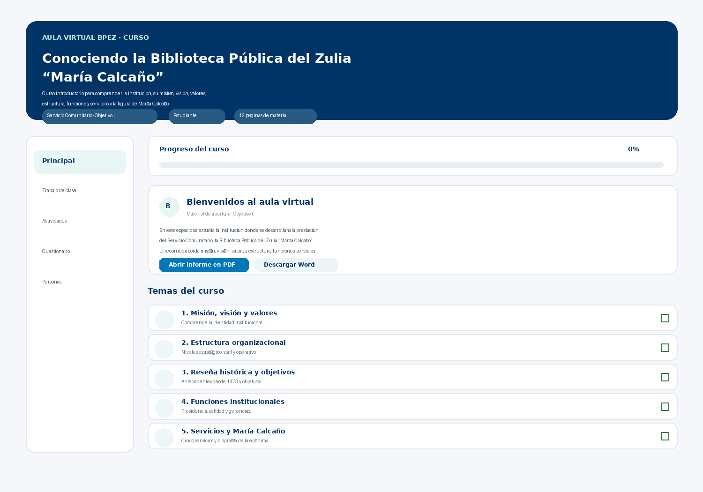

# Intranet BPEZ — Proyecto de Aula Virtual

**Modificación visual tipo Classroom**
Documentación técnica del proyecto · Versión 1.0

| Campo | Detalle |
|---|---|
| Proyecto | Intranet BPEZ — Módulo Aula Virtual |
| Curso incorporado | Conociendo la Biblioteca Pública del Zulia “María Calcaño” |
| Marco académico | Servicio Comunitario · Objetivo I: Conocer la institución |
| Institución de origen del informe | Universidad Dr. José Gregorio Hernández, Facultad de Ingeniería, Escuela de Ingeniería de Sistemas (Maracaibo, septiembre de 2026) |
| Documento fuente | `docs/Proyecto_Intranet_BPEZ_Aula_Virtual.docx` |

---

## 1. Resumen

La modificación incorpora a la Intranet BPEZ un aula virtual con una experiencia visual inspirada en plataformas educativas tipo Classroom. Funciona como módulo interno que organiza los contenidos, actividades y evaluaciones del Servicio Comunitario, sin depender de una plataforma educativa externa.

El material académico procede del informe sobre la Biblioteca Pública del Zulia “María Calcaño”, administrada por FUNDABIPEZ: misión, visión, valores, estructura, historia, funciones, servicios y biografía de María Calcaño.

## 2. Descripción de la interfaz

La pantalla principal se organiza en tres zonas: **cabecera visual**, **navegación lateral** y **tarjetas de contenido**.

- **Identidad visual:** cabecera en azul institucional (`#003366`) con acentos cian (`#00B8D9`).
- **Contenido:** tarjetas blancas, bordes suaves (20 px de radio) y sombras ligeras sobre fondo gris azulado (`#F5F7FB`).
- **Adaptabilidad:** en pantallas pequeñas la navegación lateral pasa a una barra horizontal desplazable.



*Figura 1. Representación visual de la interfaz del Aula Virtual integrada a la Intranet BPEZ.*

### 2.1 Componentes principales

| Componente | Función | Presentación visual |
|---|---|---|
| Cabecera del curso | Identifica aula, curso, objetivo y usuario | Banner azul con título, descripción y etiquetas |
| Navegación lateral | Cambia entre áreas del aula | Principal, Trabajo de clase, Actividades, Cuestionario y Personas |
| Progreso | Muestra el avance | Barra de progreso horizontal |
| Anuncio | Bienvenida y orientaciones | Tarjeta de publicación con acceso al material |
| Temas | Organiza contenidos | Tarjetas con iconos, descripción y casilla de completado |
| Actividades | Presenta tareas | Tarjetas con botón de realización |
| Cuestionario | Comprueba comprensión | Preguntas de selección y cálculo del resultado |
| Personas | Muestra autores vinculados | Tarjetas individuales con nombre y rol |

### 2.2 Esquema de la pantalla (representación esquemática)

```
┌──────────────────────────────────────────────────────────────┐
│ AULA VIRTUAL BPEZ · CURSO                       (cabecera)   │
│ Conociendo la Biblioteca Pública del Zulia “María Calcaño”   │
│ [Servicio Comunitario · Obj. I] [Usuario] [12 págs. material]│
└──────────────────────────────────────────────────────────────┘
┌────────────┐ ┌───────────────────────────────────────────────┐
│ ▣ Principal│ │ Progreso del curso                       0%   │
│   Trabajo  │ │ ▭▭▭▭▭▭▭▭▭▭▭▭▭▭▭▭▭▭▭▭▭▭▭▭▭▭▭▭▭▭▭▭▭▭▭▭▭▭▭▭     │
│   de clase │ ├───────────────────────────────────────────────┤
│   Activi-  │ │ (B) Bienvenidos al aula virtual               │
│   dades    │ │ [Abrir informe en PDF] [Descargar Word]       │
│   Cuestio- │ ├───────────────────────────────────────────────┤
│   nario    │ │ Temas del curso                               │
│   Personas │ │ ( ) 1. Misión, visión y valores            ☐  │
│            │ │ ( ) 2. Estructura organizacional           ☐  │
│            │ │ ( ) 3. Reseña histórica y objetivos        ☐  │
│            │ │ ( ) 4. Funciones institucionales           ☐  │
│            │ │ ( ) 5. Servicios y María Calcaño           ☐  │
└────────────┘ └───────────────────────────────────────────────┘
```

## 3. Lenguajes y tecnologías

| Categoría | Elemento | Uso en el módulo |
|---|---|---|
| Lenguaje | **PHP** | Acceso al módulo, lectura de sesión, comprobación de materiales, generación del HTML |
| Lenguaje | **HTML5** | Estructura semántica (`header`, `aside`, `nav`, `main`, `section`, `article`) |
| Lenguaje | **CSS3** | Variables, gradientes, tarjetas, animación de transición, diseño adaptable |
| Lenguaje | **JavaScript** | Navegación entre secciones, progreso, cuestionario |
| Tecnología | **Bootstrap 5.3.3** | Rejilla, componentes y utilidades (CDN) |
| Tecnología | **Font Awesome 6.5.2** | Iconografía (CDN) |
| Tecnología | **localStorage** | Persistencia del avance y del resultado en el navegador |

## 4. Rutas reales de los archivos

Todas las rutas son relativas a la raíz del proyecto de la Intranet.

| Ruta | Descripción |
|---|---|
| `modules/aula_virtual/aula_virtual.php` | Acceso al módulo Aula Virtual |
| `modules/aula_virtual/classroom.php` | Interfaz principal del aula tipo Classroom |
| `frontend/aula_virtual_frontend.php` | Componente frontend relacionado con el módulo |
| `assets/materiales/aula_virtual/` | Carpeta de materiales académicos (PDF y DOCX) |
| `AULA_VIRTUAL_README.txt` | Documentación del módulo |

Archivos adicionales de este paquete, que no afectan al sistema: `assets/materiales/aula_virtual/LEEME.txt` y la carpeta `docs/`.

## 5. Compatibilidad con `Intranet_BPEZ_Aula_Virtual_Classroom.zip`

- El paquete reproduce **exactamente** la estructura de rutas del apartado 4; al extraerlo en la raíz del proyecto, los archivos quedan en las ubicaciones esperadas.
- No modifica ni requiere archivos fuera de esas rutas, no usa base de datos y no depende de includes del sistema anfitrión.
- Si el proyecto ya contiene versiones previas de estos mismos archivos, se sobrescribirán: conviene respaldarlos antes.
- **Nota:** este paquete se generó a partir del documento del proyecto. El contenido interno de `Intranet_BPEZ_Aula_Virtual_Classroom.zip` no estaba disponible durante su elaboración, por lo que las claves de sesión (`$clavesSesion`) y la ruta de inicio de sesión (`$rutaLogin`) deben verificarse contra el sistema real (ver sección 8).

## 6. Estructura del Aula Virtual

```
raíz-del-proyecto/
├── AULA_VIRTUAL_README.txt
├── modules/
│   └── aula_virtual/
│       ├── aula_virtual.php        ← punto de acceso (sesión + carga)
│       └── classroom.php           ← interfaz, estilos y lógica
├── frontend/
│   └── aula_virtual_frontend.php   ← tarjeta y enlace de menú reutilizables
├── assets/
│   └── materiales/
│       └── aula_virtual/           ← informe base en PDF y DOCX
└── docs/                           ← documentación del proyecto
```

**Secciones internas del aula:** Principal · Trabajo de clase · Actividades · Cuestionario · Personas.

### 6.1 Contenidos académicos organizados

1. Misión, visión y valores.
2. Estructura organizacional de FUNDABIPEZ.
3. Reseña histórica y objetivos institucionales.
4. Organigrama estructural.
5. Funciones de la Presidencia.
6. Funciones de la Oficina de Gestión de Calidad.
7. Funciones de la Gerencia de Servicios Bibliotecológicos.
8. Funciones de la Gerencia Social.
9. Cinco servicios de la Biblioteca Pública del Zulia.
10. Biografía de María Calcaño.

### 6.2 Materiales

El informe base se ofrece en **PDF** (lectura) y **DOCX** (descarga y consulta), dentro de `assets/materiales/aula_virtual/`, con los nombres `Informe_Biblioteca_Publica_del_Zulia.pdf` y `.docx`. Si no están copiados, los botones aparecen deshabilitados.

### 6.3 Autores del informe académico

Jhon Benavides · Andres Ferrer · Moises Alvarez · Santiago Ledesma.

## 7. Funcionalidades actuales

- Navegación lateral entre cinco áreas, sin recargar la página.
- Cabecera con el nombre del usuario (tomado de la sesión de la Intranet; “Estudiante” por defecto).
- **Tres actividades:** identificación institucional, mapa de estructura y servicios de la biblioteca, marcables como completadas.
- **Cinco temas** marcables como completados.
- **Barra de progreso** que se actualiza con temas y actividades (8 elementos en total).
- **Cuestionario de cinco preguntas** de repaso, con cálculo del resultado en el navegador y retroalimentación visual (correcta/incorrecta), y opción de reintentar.
- Persistencia por usuario mediante `localStorage` (clave `bpez_aula_virtual_v1_<usuario>`).
- Acceso al informe en PDF y descarga en Word.
- Diseño adaptable a móvil, tableta y escritorio.
- Salida escapada con `htmlspecialchars` y datos hacia JavaScript con `json_encode`.

## 8. Guía de implementación

1. Extraer el paquete en la raíz del proyecto.
2. Copiar el informe PDF y DOCX en `assets/materiales/aula_virtual/`.
3. Revisar en `aula_virtual.php`: `$requerirSesion`, `$clavesSesion` y `$rutaLogin`.
4. Enlazar el aula desde la Intranet con `aula_virtual_tarjeta()` o `aula_virtual_enlace_menu()` (ver comentarios en `frontend/aula_virtual_frontend.php`).
5. Probar en `modules/aula_virtual/aula_virtual.php`.

**Requisitos:** PHP 7.0+, navegador con JavaScript y localStorage, acceso a CDN (o recursos locales).

### Limitaciones conocidas

- El avance **no se guarda en el servidor**: depende del navegador y del equipo usado.
- El cuestionario se califica en el cliente; sus respuestas son visibles para quien inspeccione la página. Es adecuado para repaso, no para evaluación formal.
- Las preguntas del cuestionario y los textos de las actividades se redactaron a partir de la descripción del proyecto; conviene validarlos contra el informe original.
- No se incluyen el PDF ni el DOCX del informe base.

## 9. Recomendaciones de futuras ampliaciones

| Prioridad | Ampliación | Beneficio |
|---|---|---|
| Alta | Persistencia en base de datos (progreso, notas, intentos) | Seguimiento real por estudiante y entre dispositivos |
| Alta | Entrega de actividades (carga de archivos) y calificación por el docente | Cierra el ciclo de trabajo de clase |
| Media | Panel docente con reportes de avance y exportación a Excel/PDF | Supervisión del Servicio Comunitario |
| Media | Banco de preguntas editable, con aleatorización y varios intentos | Evaluación más robusta |
| Media | Roles (estudiante, docente, administrador) integrados con la Intranet | Control de acceso |
| Media | Anuncios y comentarios por curso | Comunicación tipo Classroom |
| Baja | Varios cursos y objetivos del Servicio Comunitario | Escalabilidad |
| Baja | Certificado automático al completar el 100 % | Reconocimiento |
| Baja | Recursos locales (sin CDN), modo oscuro y mejoras de accesibilidad (WCAG) | Uso sin internet e inclusión |

## 10. Resultado esperado

La Intranet BPEZ dispone de un espacio educativo interno que organiza el material del Servicio Comunitario en una interfaz clara, adaptable a dispositivos y orientada al seguimiento del estudiante.

## 11. Referencia del material base

Informe Biblioteca Pública del Zulia. Primer Informe — Objetivo I. Conocer la institución. Universidad Dr. José Gregorio Hernández, Facultad de Ingeniería, Escuela de Ingeniería de Sistemas, Servicio Comunitario, Maracaibo, septiembre de 2026.
